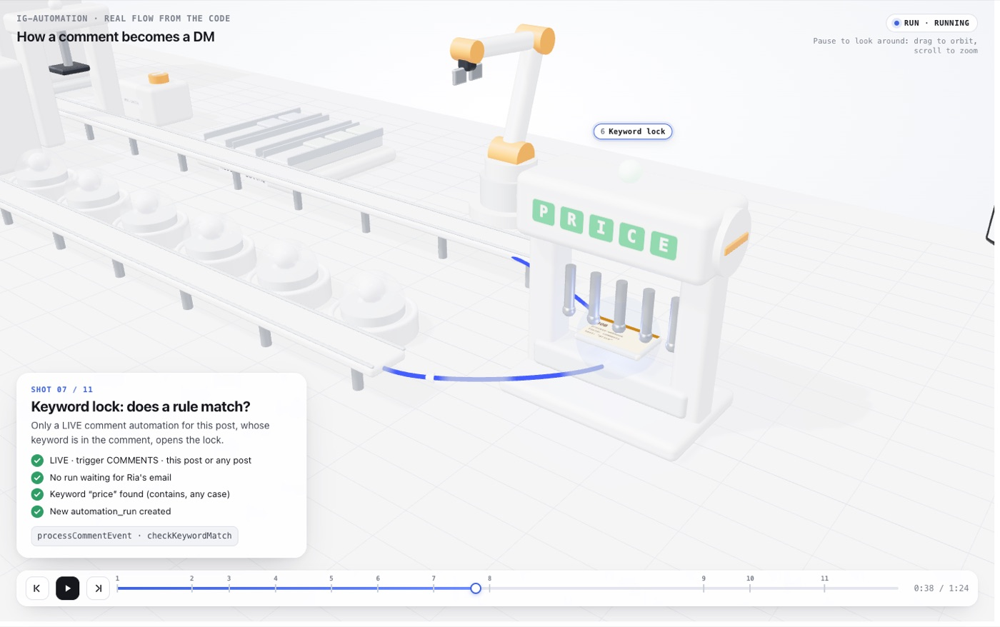
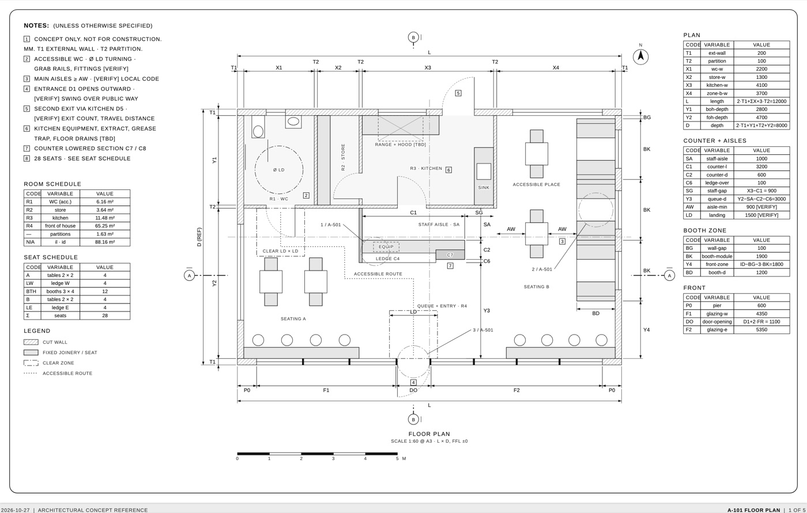
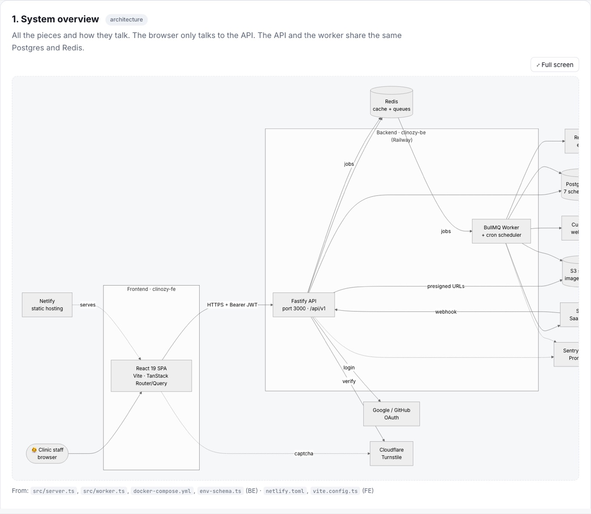

# Daily AI Experiments

One new AI skill or tool every day, with each result running live in the browser. Nothing to download or install.

**🌐 Website:** https://rimeet-mavani-albetrios.github.io/daily-ai-showcase/

Each day has its own link that shows only that day.

| Day | Date | Preview | ▶ Live demo | What I built | Skill |
|---|---|---|---|---|---|
| 001 | 2026-10-25 |  | [▶ Open Day 001](https://rimeet-mavani-albetrios.github.io/daily-ai-showcase/day-001/) | Instagram comment to DM, as a live 3D machine | [Anatomy](https://github.com/wheresryan22/anatomy) + three.js |
| 002 | 2026-10-26 |  | [▶ Open Day 002](https://rimeet-mavani-albetrios.github.io/daily-ai-showcase/day-002/) | Client review turned into a 39 s testimonial Reel | [HyperFrames](https://github.com/heygen-com/hyperframes) (HeyGen) |
| 003 | 2026-10-27 |  | [▶ Open Day 003](https://rimeet-mavani-albetrios.github.io/daily-ai-showcase/day-003/) | Architectural drawing sets: a 28-seat café (5 sheets) and a G+1 house with two 2 BHK flats + parking (12 sheets) | [dimensional-drawing](https://github.com/enesozturk/dimensional-drawing) |
| 004 | 2026-10-29 |  | [▶ Open Day 004](https://rimeet-mavani-albetrios.github.io/daily-ai-showcase/day-004/) | A real clinic app (FE + BE, ~9,000 files) explained in 14 engineering diagrams: architecture, database, login, business flows | [Understand Anything](https://github.com/Egonex-AI/Understand-Anything) + [Mermaid](https://mermaid.js.org) |
